# E-Commerce Web Application – Use Case Decomposition

Companion to [ecommerce-use-cases.md](./ecommerce-use-cases.md) and [ecommerce-use-case-diagrams.md](./ecommerce-use-case-diagrams.md). Each diagram breaks a use case into sub-use-cases (functions), top-down.

**Legend**
- Rectangle at the top = the use case being decomposed.
- Solid arrow = mandatory sub-use-case (**include** / part of the main flow).
- Dashed arrow labelled `extend` = optional or conditional sub-use-case (alternative flow).
- Rounded node = an external actor/system or another use case referenced (e.g. `UC-29`).
- Leaf nodes are the smallest steps to implement.

---

## 1. Customer-facing use cases

### UC-01 Register Account
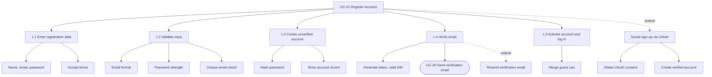

### UC-02 Log In / Log Out
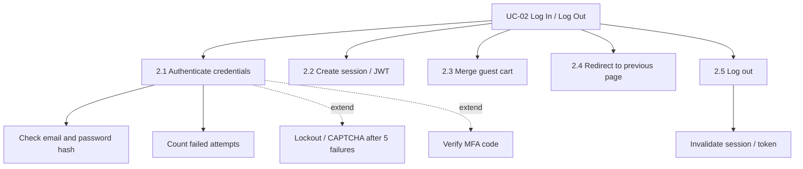

### UC-03 Reset Password
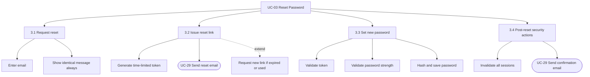

### UC-04 Manage Profile & Addresses
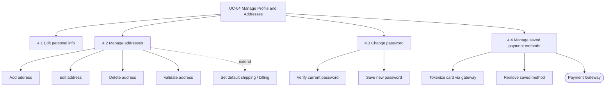

### UC-05 Browse Catalog by Category
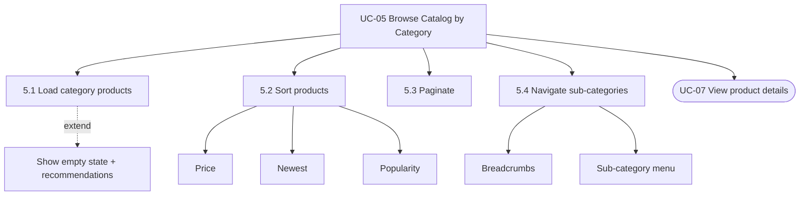

### UC-06 Search & Filter Products
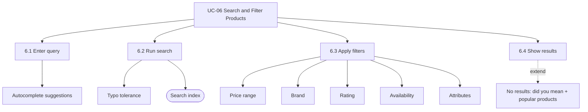

### UC-07 View Product Details
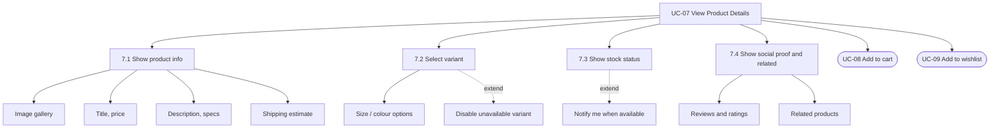

### UC-08 Manage Shopping Cart
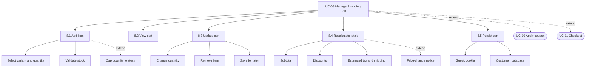

### UC-09 Manage Wishlist
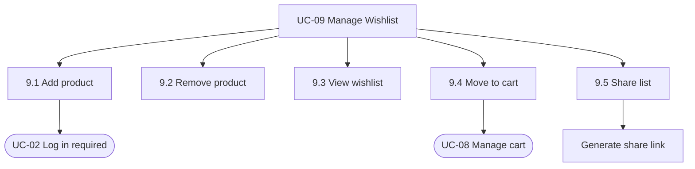

### UC-10 Apply Coupon / Discount Code
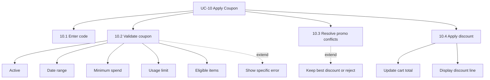

### UC-11 Checkout & Place Order
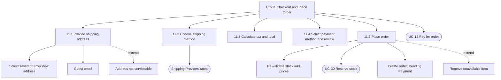

### UC-12 Pay for Order
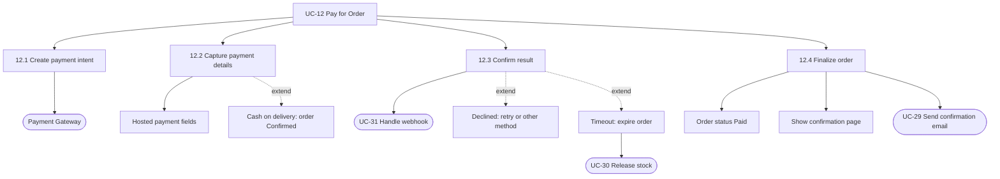

### UC-13 Track Order
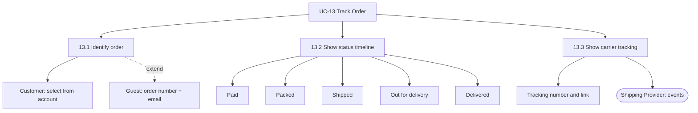

### UC-14 View Order History
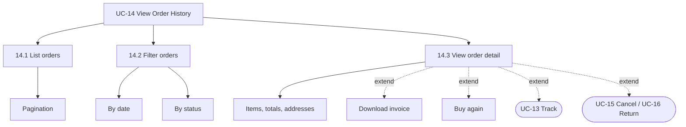

### UC-15 Cancel Order
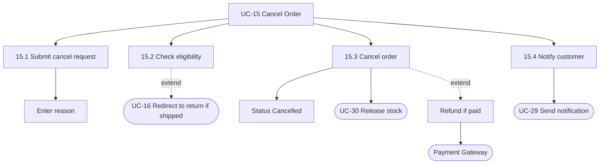

### UC-16 Request Return / Refund
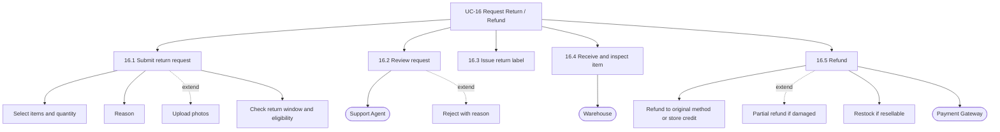

### UC-17 Write Product Review & Rating
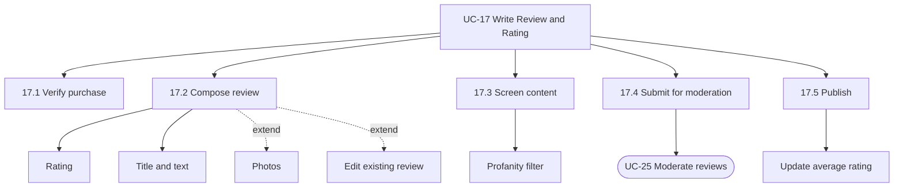

### UC-18 Contact Customer Support
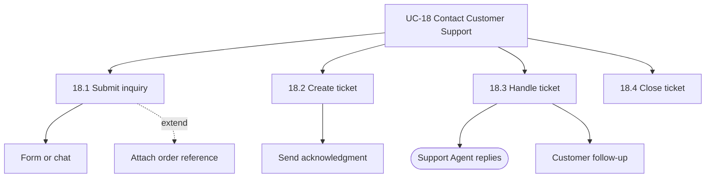

---

## 2. Back-office use cases

### UC-19 Manage Products & Categories
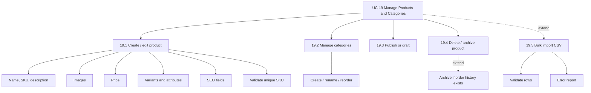

### UC-20 Manage Inventory
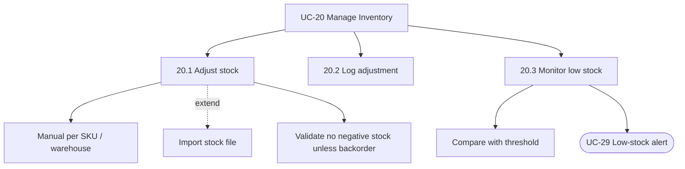

### UC-21 Manage Orders
```mermaid
flowchart TD
    UC["UC-21 Manage Orders"]
    UC --> A["21.1 Search and filter orders"]
    UC --> B["21.2 View order"]
    UC --> C["21.3 Update status"]
    UC --> D["21.4 Fulfil shipment"]
    UC --> E["21.5 Notify customer"]
    C --> C1["Packed"]
    C --> C2["Shipped"]
    D --> D1["Enter or generate tracking number"]
    D --> D2["Print label"]
    D --> D3(["Shipping Provider"])
    D -.->|extend| D4["Split shipment"]
    B -.->|extend| B1["Edit address before shipping"]
    B -.->|extend| B2["Cancel order + refund"]
    E --> E1(["UC-29 Send notification"])
```

### UC-22 Process Returns & Refunds
```mermaid
flowchart TD
    UC["UC-22 Process Returns and Refunds"]
    UC --> A["22.1 Review return requests"]
    UC --> B["22.2 Approve / reject"]
    UC --> C["22.3 Confirm receipt"]
    UC --> D["22.4 Issue refund"]
    UC --> E["22.5 Record in audit log"]
    D --> D1["Full refund"]
    D -.->|extend| D2["Partial refund"]
    D --> D3(["Payment Gateway"])
    D -.->|extend| D4["Flag failed refund for manual handling"]
```

### UC-23 Manage Customers
```mermaid
flowchart TD
    UC["UC-23 Manage Customers"]
    UC --> A["23.1 Search customers"]
    UC --> B["23.2 View profile and orders"]
    UC --> C["23.3 Change account status"]
    UC --> D["23.4 Handle GDPR request"]
    C --> C1["Deactivate"]
    C --> C2["Reactivate"]
    D --> D1["Anonymize personal data"]
    D -.->|extend| D2["Export customer data"]
```

### UC-24 Manage Promotions & Coupons
```mermaid
flowchart TD
    UC["UC-24 Manage Promotions and Coupons"]
    UC --> A["24.1 Define promotion type"]
    UC --> B["24.2 Set conditions"]
    UC --> C["24.3 Set validity and limits"]
    UC --> D["24.4 Activate / deactivate"]
    A --> A1["Percentage"]
    A --> A2["Fixed amount"]
    A --> A3["Free shipping"]
    A --> A4["BOGO"]
    B --> B1["Minimum spend"]
    B --> B2["Eligible products / categories"]
    C --> C1["Start and end dates"]
    C --> C2["Usage limits"]
    D --> D1["Automatic rule"]
    D -.->|extend| D2["Generate coupon codes"]
```

### UC-25 Moderate Reviews
```mermaid
flowchart TD
    UC["UC-25 Moderate Reviews"]
    UC --> A["25.1 List pending / flagged reviews"]
    UC --> B["25.2 Decide"]
    B --> B1["Approve"]
    B --> B2["Reject"]
    B --> B3["Delete"]
    B1 --> C["Update average rating"]
    B2 --> D(["UC-29 Notify author"])
```

### UC-26 View Sales Reports & Analytics
```mermaid
flowchart TD
    UC["UC-26 View Reports and Analytics"]
    UC --> A["26.1 Select date range"]
    UC --> B["26.2 Generate metrics"]
    UC --> C["26.3 Display dashboard"]
    UC -.->|extend| D["26.4 Export CSV / PDF"]
    B --> B1["Revenue and orders"]
    B --> B2["Average order value"]
    B --> B3["Conversion"]
    B --> B4["Top products"]
    B --> B5["Stock value"]
    B --> B6["Refunds"]
```

### UC-27 Configure Shipping, Tax & Payment Settings
```mermaid
flowchart TD
    UC["UC-27 Configure Settings"]
    UC --> A["27.1 Shipping settings"]
    UC --> B["27.2 Tax settings"]
    UC --> C["27.3 Payment settings"]
    UC --> D["27.4 Store information"]
    UC --> E["27.5 Email templates"]
    A --> A1["Zones"]
    A --> A2["Rates"]
    B --> B1["Tax rules per region"]
    C --> C1["Enable payment methods"]
    C --> C2["Gateway credentials"]
    UC --> F["27.6 Save and audit log"]
```

### UC-28 Manage Staff Roles & Permissions
```mermaid
flowchart TD
    UC["UC-28 Manage Staff Roles and Permissions"]
    UC --> A["28.1 Manage staff accounts"]
    UC --> B["28.2 Manage roles"]
    UC --> C["28.3 Enforce RBAC"]
    UC --> D["28.4 Audit sensitive actions"]
    A --> A1["Create"]
    A --> A2["Edit / disable"]
    B --> B1["Catalog Manager"]
    B --> B2["Order Manager"]
    B --> B3["Support"]
    B --> B4["Assign permissions"]
    C --> C1["Check permission per request"]
    C -.->|extend| C2["Deny and log"]
```

---

## 3. System / automated use cases

### UC-29 Send Transactional Notifications
```mermaid
flowchart TD
    UC["UC-29 Send Transactional Notifications"]
    UC --> A["29.1 Receive trigger event"]
    UC --> B["29.2 Render template"]
    UC --> C["29.3 Send message"]
    UC --> D["29.4 Log delivery"]
    A --> A1["Registration, order, payment"]
    A --> A2["Shipped, delivered, refund, reset"]
    C --> C1["Email"]
    C --> C2["SMS"]
    C --> C3(["Notification Service"])
    C -.->|extend| C4["Retry with backoff"]
```

### UC-30 Reserve & Release Stock
```mermaid
flowchart TD
    UC["UC-30 Reserve and Release Stock"]
    UC --> A["30.1 Reserve stock"]
    UC --> B["30.2 Commit stock"]
    UC --> C["30.3 Release stock"]
    A --> A1["Atomic availability check"]
    A --> A2["Decrement available quantity"]
    B --> B1["On payment success"]
    C --> C1["On payment expiry"]
    C --> C2["On order cancel"]
    C --> C3["Scheduled expiry sweep"]
```

### UC-31 Handle Payment Webhooks
```mermaid
flowchart TD
    UC["UC-31 Handle Payment Webhooks"]
    UC --> A["31.1 Receive event"]
    UC --> B["31.2 Verify signature"]
    UC --> C["31.3 Deduplicate event"]
    UC --> D["31.4 Update payment and order"]
    UC --> E["31.5 Respond 200"]
    A --> A1(["Payment Gateway"])
    C -.->|extend| C1["Ignore and log unknown / duplicate"]
    D --> D1(["UC-29 Trigger notifications"])
    B -.->|extend| B1["Reject and alert on invalid signature"]
```

### UC-32 Abandoned Cart Reminder
```mermaid
flowchart TD
    UC["UC-32 Abandoned Cart Reminder"]
    UC --> A["32.1 Detect idle carts, 24h"]
    UC --> B["32.2 Check eligibility"]
    UC --> C["32.3 Send reminder"]
    UC --> D["32.4 Stop reminders"]
    B --> B1["Email known"]
    B --> B2["Not purchased"]
    B --> B3["Not unsubscribed"]
    C --> C1(["UC-29 Send notification"])
    C -.->|extend| C2["Include incentive"]
    D --> D1["On purchase"]
    D --> D2["On unsubscribe"]
```
