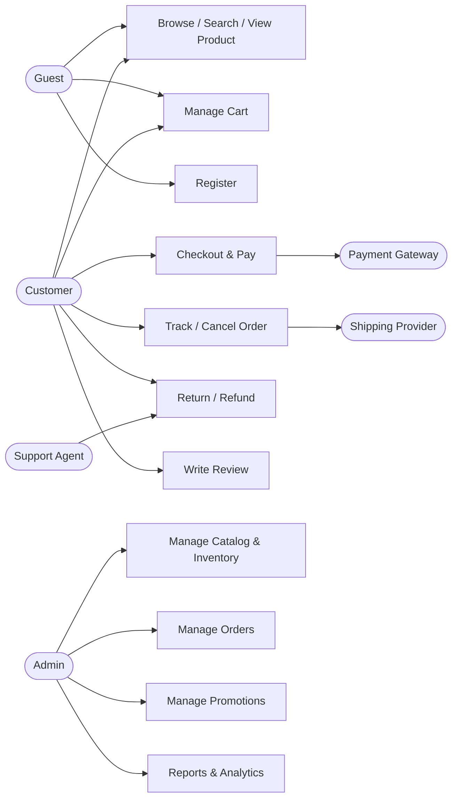
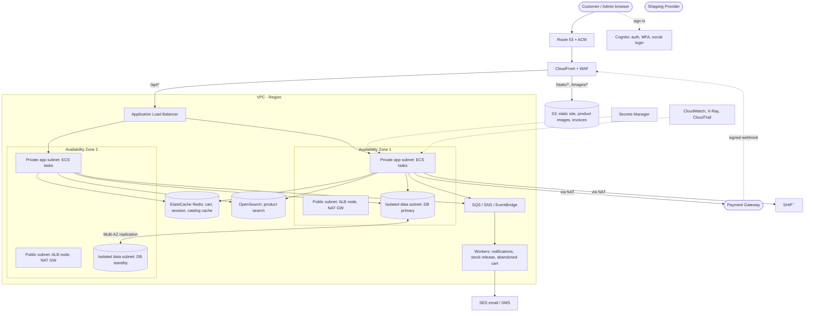

# E-Commerce Web Application – Use Cases

## 1. Actors

| Actor | Description |
|---|---|
| Guest | Unregistered visitor who can browse and (optionally) check out |
| Customer | Registered, logged-in buyer |
| Admin | Back-office user managing catalog, orders, users, and settings |
| Support Agent | Handles customer inquiries, returns, refunds |
| Payment Gateway (external) | Processes payments (e.g., Stripe, PayPal, VNPay) |
| Shipping Provider (external) | Calculates rates, creates labels, tracks parcels |
| Notification Service (external) | Sends email/SMS/push |

---

## 2. General Use Case Overview

### 2.1 Customer-facing

| ID | Use Case | Actors |
|---|---|---|
| UC-01 | Register account | Guest |
| UC-02 | Log in / Log out | Customer |
| UC-03 | Reset password | Customer |
| UC-04 | Manage profile & addresses | Customer |
| UC-05 | Browse catalog by category | Guest, Customer |
| UC-06 | Search & filter products | Guest, Customer |
| UC-07 | View product details | Guest, Customer |
| UC-08 | Manage shopping cart | Guest, Customer |
| UC-09 | Manage wishlist | Customer |
| UC-10 | Apply coupon / discount code | Guest, Customer |
| UC-11 | Checkout & place order | Guest, Customer |
| UC-12 | Pay for order | Customer, Payment Gateway |
| UC-13 | Track order | Customer, Shipping Provider |
| UC-14 | View order history | Customer |
| UC-15 | Cancel order | Customer |
| UC-16 | Request return / refund | Customer, Support Agent |
| UC-17 | Write product review & rating | Customer |
| UC-18 | Contact customer support | Guest, Customer |

### 2.2 Back-office

| ID | Use Case | Actors |
|---|---|---|
| UC-19 | Manage products & categories | Admin |
| UC-20 | Manage inventory | Admin |
| UC-21 | Manage orders (process, ship, cancel) | Admin |
| UC-22 | Process returns & refunds | Admin, Support Agent |
| UC-23 | Manage customers | Admin |
| UC-24 | Manage promotions & coupons | Admin |
| UC-25 | Moderate reviews | Admin |
| UC-26 | View sales reports & analytics | Admin |
| UC-27 | Configure shipping, tax & payment settings | Admin |
| UC-28 | Manage staff roles & permissions | Admin |

### 2.3 System / automated

| ID | Use Case | Actors |
|---|---|---|
| UC-29 | Send transactional notifications | Notification Service |
| UC-30 | Reserve & release stock | System |
| UC-31 | Handle payment webhooks | Payment Gateway |
| UC-32 | Abandoned cart reminder | System |

### 2.4 Diagram (Mermaid)

---

## 3. Detailed Use Cases

### UC-01 Register Account
- **Actor:** Guest
- **Goal:** Create a customer account.
- **Preconditions:** Email not already registered.
- **Trigger:** Guest clicks "Sign up".
- **Main flow:**
  1. Guest enters name, email, password (and accepts terms).
  2. System validates input (format, password strength, unique email).
  3. System creates the account in "unverified" state.
  4. System sends a verification email.
  5. Guest clicks the verification link; system activates the account and logs them in.
- **Alternative flows:**
  - 2a. Email already exists → show error and offer login / reset password.
  - 5a. Link expired → user may request a new verification email.
  - Social sign-up (Google/Facebook) → skips steps 1–4 after OAuth consent.
- **Postconditions:** Active customer account exists; cart (if any) is merged.
- **Business rules:** Passwords hashed; verification link valid 24h.

### UC-02 Log In / Log Out
- **Actor:** Customer
- **Preconditions:** Account verified.
- **Main flow:** Enter credentials → system authenticates → creates session/JWT → redirects to previous page → guest cart merged into customer cart.
- **Alternatives:** Invalid credentials → generic error; 5 failed attempts → temporary lockout/CAPTCHA; MFA enabled → prompt for code.
- **Postconditions:** Authenticated session; logout invalidates it.

### UC-03 Reset Password
- **Main flow:** Enter email → system sends time-limited reset link (always shows the same message to avoid account enumeration) → user sets a new password → all sessions invalidated → confirmation email sent.
- **Alternatives:** Expired/used token → request a new link.

### UC-04 Manage Profile & Addresses
- **Main flow:** Customer edits personal info, adds/edits/deletes shipping & billing addresses, sets a default address, changes password, manages saved payment methods (tokenized).
- **Rules:** Addresses validated; card data never stored on our servers (gateway tokens only).

### UC-05 Browse Catalog by Category
- **Main flow:** User opens category → system lists products with pagination, sorting (price, newest, popularity) → user navigates sub-categories via breadcrumbs.
- **Alternative:** Empty category → show message and recommended products.

### UC-06 Search & Filter Products
- **Main flow:** User types a query → system shows autocomplete suggestions → submits → results list → user applies filters (price, brand, rating, availability, attributes) → results update.
- **Alternatives:** No results → "did you mean…" and popular products; typo tolerance.

### UC-07 View Product Details
- **Main flow:** System shows images/gallery, title, price, variants (size/color), stock status, description, specs, reviews, related products, shipping estimate.
- **Alternatives:** Out of stock → "Notify me when available"; variant unavailable → option disabled.

### UC-08 Manage Shopping Cart
- **Actors:** Guest, Customer
- **Main flow:**
  1. User selects variant and quantity, clicks "Add to cart".
  2. System validates stock and adds item; cart badge updates.
  3. User opens cart; can change quantity, remove items, or "save for later".
  4. System recalculates subtotal, discounts, estimated tax/shipping.
- **Alternatives:** Quantity exceeds stock → cap and inform user; price changed since added → show notice.
- **Postconditions:** Cart persisted (cookie for guests, DB for customers).

### UC-09 Manage Wishlist
- **Main flow:** Customer adds/removes products, moves items to cart, shares list.
- **Alternative:** Guest clicks wishlist → prompted to log in.

### UC-10 Apply Coupon / Discount Code
- **Main flow:** User enters code → system validates (active, date range, min spend, usage limit, eligible items) → discount applied and shown.
- **Alternatives:** Invalid/expired/ineligible → specific error message; non-stackable with another promo → keep best or reject.

### UC-11 Checkout & Place Order
- **Actors:** Guest, Customer
- **Preconditions:** Cart not empty; all items in stock.
- **Main flow:**
  1. User clicks "Checkout".
  2. User provides/selects shipping address (guest also gives email).
  3. System fetches shipping options and rates from the shipping provider; user selects one.
  4. System calculates tax and final total.
  5. User selects payment method and reviews the order.
  6. User clicks "Place order" → system re-validates stock and prices, reserves stock, creates order (status *Pending Payment*) → proceeds to UC-12.
- **Alternatives:**
  - 6a. Item became unavailable → inform user, allow removing the item.
  - 2a. Address not serviceable → ask for another address.
- **Postconditions:** Order created; stock reserved.

### UC-12 Pay for Order
- **Actors:** Customer, Payment Gateway
- **Main flow:**
  1. System creates a payment intent with the gateway.
  2. Customer enters payment details on the gateway-hosted form (3-D Secure if required).
  3. Gateway confirms payment; system receives the result/webhook.
  4. Order status → *Paid*; confirmation page shown; confirmation email sent (UC-29).
- **Alternatives:**
  - 3a. Payment declined → show reason, allow retry or another method; order stays *Pending Payment*.
  - 3b. Timeout/abandoned → reservation released after N minutes (UC-30), order → *Expired*.
  - Cash on delivery → order → *Confirmed* without online payment.
- **Rules:** Idempotent webhook handling; no card data stored; PCI-DSS scope minimized.

### UC-13 Track Order
- **Main flow:** Customer opens order → sees status timeline (Paid → Packed → Shipped → Out for delivery → Delivered) and carrier tracking link/number.
- **Alternative:** Guest tracks via order number + email.

### UC-14 View Order History
- **Main flow:** Customer views paginated list with filters (date, status) → opens an order for items, totals, addresses, invoice download, "Buy again".

### UC-15 Cancel Order
- **Preconditions:** Order not yet shipped.
- **Main flow:** Customer requests cancel + reason → system verifies eligibility → cancels, releases stock, triggers refund if paid → notifies customer.
- **Alternative:** Already shipped → system redirects to return flow (UC-16).

### UC-16 Request Return / Refund
- **Actors:** Customer, Support Agent
- **Preconditions:** Order delivered within the return window (e.g., 30 days); item eligible.
- **Main flow:**
  1. Customer selects order items, quantity, and reason (optionally uploads photos).
  2. System creates return request (*Requested*) and notifies support.
  3. Agent/Admin reviews and approves; system issues return label/instructions.
  4. Customer ships item; warehouse marks as received and inspects.
  5. System refunds to original payment method (or store credit); stock updated if resellable.
- **Alternatives:** Request rejected (outside window / non-returnable) → reason sent; partial refund for damaged item.

### UC-17 Write Product Review & Rating
- **Preconditions:** Customer purchased the product (verified purchase).
- **Main flow:** Customer submits rating, title, text, photos → system queues for moderation (UC-25) → published → average rating updated.
- **Alternatives:** Duplicate review → edit existing; profanity filter flags content.

### UC-18 Contact Customer Support
- **Main flow:** User submits form/chat (with optional order reference) → system creates ticket, sends acknowledgment → agent replies → ticket resolved/closed.

### UC-19 Manage Products & Categories
- **Actor:** Admin
- **Main flow:** Admin creates/edits a product (name, SKU, description, images, price, variants, attributes, SEO fields, category) → saves as draft or publishes → product appears on storefront.
- **Alternatives:** Duplicate SKU → validation error; bulk import via CSV with error report; deleting a product with order history → archive instead.

### UC-20 Manage Inventory
- **Main flow:** Admin updates stock levels per SKU/warehouse (manual or import) → system logs the adjustment → low-stock alert triggers when below threshold.
- **Rules:** Negative stock not allowed unless backorders enabled.

### UC-21 Manage Orders
- **Main flow:** Admin views/filters orders → opens order → changes status (Packed, Shipped), enters/generates tracking number and label → system notifies customer.
- **Alternatives:** Edit address before shipping; cancel order with refund; split shipment.

### UC-22 Process Returns & Refunds
- **Main flow:** Admin/Agent reviews return requests → approve/reject → on receipt, issue full/partial refund via gateway → record in audit log.
- **Alternative:** Gateway refund fails → flag for manual handling.

### UC-23 Manage Customers
- **Main flow:** Admin searches customers, views profile and orders, deactivates/reactivates accounts, anonymizes data upon GDPR request.

### UC-24 Manage Promotions & Coupons
- **Main flow:** Admin defines promotion type (percentage, fixed, free shipping, BOGO), conditions, validity, usage limits → activates → system applies automatically or via code.

### UC-25 Moderate Reviews
- **Main flow:** Admin sees pending/flagged reviews → approve, reject, or delete → author notified if rejected.

### UC-26 View Sales Reports & Analytics
- **Main flow:** Admin selects date range → system shows revenue, orders, AOV, conversion, top products, stock value, refunds → export to CSV/PDF.

### UC-27 Configure Shipping, Tax & Payment Settings
- **Main flow:** Admin sets shipping zones/rates, tax rules per region, enabled payment methods, store info, email templates.

### UC-28 Manage Staff Roles & Permissions
- **Main flow:** Admin creates staff accounts, assigns roles (Catalog Manager, Order Manager, Support) → system enforces RBAC; all sensitive actions are audit-logged.

### UC-29 Send Transactional Notifications
- **Trigger:** Events such as registration, order placed, payment confirmed, shipped, delivered, refund issued, password reset.
- **Flow:** System renders template → sends via email/SMS → logs delivery; failed sends retried with backoff.

### UC-30 Reserve & Release Stock
- **Flow:** On order creation stock is reserved; on payment success it is committed; on payment expiry/cancel it is released. Prevents overselling under concurrent checkouts.

### UC-31 Handle Payment Webhooks
- **Flow:** Gateway posts event → system verifies signature → idempotently updates payment/order status → returns 200. Unknown/duplicate events are ignored and logged.

### UC-32 Abandoned Cart Reminder
- **Trigger:** Cart with items idle for 24h and user email known.
- **Flow:** System sends reminder (optionally with incentive); stops when the user purchases or unsubscribes.

---

## 4. Order Status Lifecycle

`Pending Payment → Paid → Processing → Shipped → Delivered → (Return Requested → Returned → Refunded)`
Side exits: `Pending Payment → Expired`, `Paid/Processing → Cancelled → Refunded`.

## 5. Key Non-Functional Requirements

- **Security:** HTTPS, hashed passwords, RBAC, CSRF/XSS protection, rate limiting, PCI-DSS via hosted payment fields.
- **Performance:** Product pages < 2s; search results < 500ms; caching/CDN for catalog.
- **Availability & integrity:** Transactional order creation, idempotent payments, no overselling.
- **Compliance:** GDPR/privacy (consent, data export/delete), tax/invoice requirements.
- **Usability:** Responsive/mobile-first, accessibility (WCAG 2.1 AA), SEO-friendly URLs.

---

## 6. High-Level Architecture (AWS)

### 6.1 Diagram

### 6.2 Design decisions

| Concern | Decision | Rationale |
|---|---|---|
| Edge | CloudFront + WAF in front of everything | Caching, DDoS and bot protection, single TLS entry point |
| API layer | ALB directly to ECS; API Gateway only if throttling/API keys are needed | Avoids a redundant hop and extra cost |
| Compute | ECS on Fargate, stateless services, auto scaling on CPU/request count | No servers to patch; scales for sales peaks |
| Network | 3 tiers per AZ (public / private app / isolated data), 2+ AZs | Only the ALB is internet-facing; DB unreachable from outside |
| Database | Aurora/RDS Multi-AZ, read replica for catalog reads, PITR backups | No single point of failure; defined RPO/RTO |
| Cache | Redis for cart, sessions, hot catalog data | Fast reads; offloads DB |
| Search | OpenSearch (or DB full-text for small catalogs) | Filtering, autocomplete, typo tolerance |
| Async work | SQS/SNS/EventBridge + workers | Webhooks, emails, stock-release timers, retries without blocking checkout |
| Security | WAF, security groups per tier, Secrets Manager, KMS encryption, hosted payment fields | PCI scope minimized; no card data stored |
| Admin | Separate path/host with its own WAF rules, SSO/MFA, optional IP allow-list | Smaller attack surface for back-office |
| Observability | CloudWatch metrics/alarms, X-Ray traces, CloudTrail audit | Detect checkout/payment failures quickly |

### 6.3 Use case to component mapping

| Use cases | Main components |
|---|---|
| UC-01 to UC-04 (accounts, profile) | Cognito, app service, DB |
| UC-05 to UC-07 (browse, search, product) | CloudFront, S3 (images), OpenSearch, Redis, DB read replica |
| UC-08 to UC-10 (cart, wishlist, coupons) | Redis (cart), app service, DB |
| UC-11, UC-12, UC-30, UC-31 (checkout, payment, stock, webhooks) | App service, DB transactions (stock reservation), payment gateway, SQS, idempotent webhook endpoint |
| UC-13 to UC-16 (tracking, cancel, returns) | App service, shipping provider API, DB, SQS |
| UC-17, UC-25 (reviews) | App service, DB, S3 (photos) |
| UC-18 (support) | App service, SES, optional helpdesk integration |
| UC-19 to UC-28 (back-office) | Admin app (separate path), DB, S3, reporting via read replica or analytics store |
| UC-29, UC-32 (notifications, abandoned cart) | SNS/SQS, workers, SES, EventBridge Scheduler |

### 6.4 Open decisions
- API Gateway needed, or ALB only?
- Fargate vs EC2-backed ECS (the original sketch showed both).
- One modular monolith vs several services (start with a modular monolith and split later if needed).
- Single region with multi-AZ, or multi-region disaster recovery? Define RPO/RTO first.
- Aurora vs RDS PostgreSQL/MySQL, and OpenSearch vs DB full-text search.
